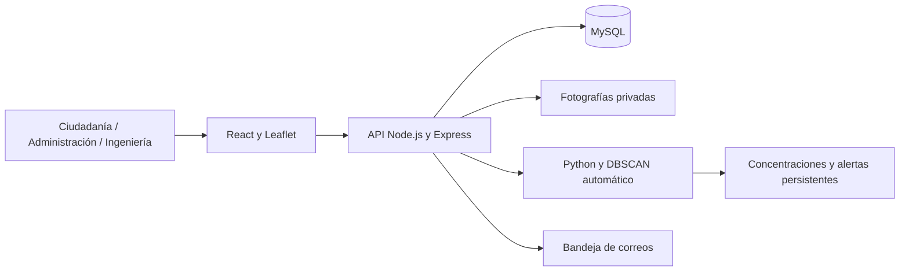

# Arquitectura de la aplicación

React presenta los formularios y el mapa Leaflet. La API Node.js verifica sesiones y permisos, almacena los datos en MySQL y ejecuta el análisis Python sin enviar datos personales.

## Datos en español

| Tabla | Contenido |
| --- | --- |
| usuarios | Nombre, correo, resumen de contraseña y rol |
| sesiones | Hash del token, usuario y vencimiento |
| reportes | Incidencia, dirección, ubicación, contacto y estado |
| fotografias | Archivo privado y categoría de evidencia |
| historial_reportes | Estado anterior, nuevo, responsable y fecha |
| notificaciones | Destinatario, mensaje y lectura |
| correos_pendientes | Correo por entregar, intentos y resultado |
| estado_concentraciones | Huella y último resultado del análisis automático |
| concentraciones | Identidad, integrantes, ubicación, umbral de avisos y vigencia de cada zona |
| notificaciones_concentracion | Relación entre una alerta, su zona, destinatario y umbral para evitar duplicados |

Los estados son Pendiente, En proceso de resolución, Resuelto y Finalizado. Los roles son ciudadano, administracion e ingeniero. El estado, la evidencia, el historial y los avisos de una transición se confirman juntos; MySQL bloquea la fila durante la actualización para impedir cambios concurrentes contradictorios.

## Rutas

| Ruta | Uso |
| --- | --- |
| GET /api/configuracion | Área de cobertura |
| GET /api/salud | Disponibilidad del servicio y motor de datos |
| GET /api/publico/panel | Indicadores agregados, puntos del mapa, actividad reciente y concentraciones sin sesión |
| GET /api/publico/analisis | Análisis de filtros del mapa público, sin datos internos del motor |
| POST /api/autenticacion/registro | Cuenta ciudadana |
| POST /api/autenticacion/ingresar | Inicio de sesión |
| GET /api/autenticacion/sesion | Usuario autenticado |
| POST /api/autenticacion/salir | Revocación de sesión |
| GET y POST /api/reportes | Consulta autorizada y registro de incidencias |
| GET /api/reportes/:id | Detalle, fotos e historial autorizado |
| POST /api/reportes/:id/estado | Transición con supervisor o evidencia según corresponda |
| GET /api/ingenieros | Supervisores para administración |
| GET /api/fotografias/:id | Imagen con autorización del reporte |
| GET /api/mapa | Reportes activos sin datos de contacto |
| GET /api/analisis | Agrupamiento geográfico |
| GET /api/concentraciones | Último resultado global del servicio automático y estado de actualización |
| GET /api/notificaciones | Avisos del destinatario |
| POST /api/notificaciones/:id/leer | Marca un aviso propio como leído |

Los filtros utilizan estado, tipo, desde, hasta y busqueda. Las fechas se interpretan en Ciudad de México. DBSCAN trabaja con vecindad de 150 metros y tres puntos mínimos; se limita a 2000 reportes por atender. La capa de calor es una visualización diferente del agrupamiento. El servidor solicita detección al iniciar y después de crear o cambiar un reporte, además de revisar cada 30 segundos. React consulta las actualizaciones cada 15 segundos y aplica los filtros de análisis automáticamente. Las consultas de vista no generan alertas.

El servicio conserva el resultado y la identidad de las zonas en MySQL, empareja grupos por integrantes compartidos y serializa la publicación mediante la fila de estado. Genera una notificación para cada cuenta de alcaldía al detectar una zona y al duplicarse su cantidad; la clave única del destinatario, zona y umbral evita repeticiones. Los registros resueltos y finalizados dejan de sumar. Los avisos anteriores se conservan como historial y permiten abrir la ubicación. Si falla el análisis, se conserva el resultado previo y la interfaz indica que no está actualizado.

## Acceso y protección

La ciudadanía consulta los detalles de sus reportes. Ingeniería consulta únicamente asignaciones y recibe los datos necesarios, sin el correo o teléfono del ciudadano. Administración revisa y gestiona el conjunto. La autorización se comprueba en cada acceso del servidor, incluidas las fotografías. El mapa comunitario comparte ubicaciones y estados.

El dashboard inicial es público y usa únicamente dos consultas de lectura bajo /api/publico/. Sus respuestas seleccionan campos concretos y no contienen contactos, cuentas, fotografías, descripciones privadas ni notificaciones. El análisis público comparte la cola y los parámetros validados del servidor, pero omite datos internos del motor y errores de configuración. Las rutas privadas conservan la comprobación de sesión. El cliente pide acceso al intentar crear un reporte, oculta la gestión sin sesión y vuelve al dashboard público al salir o vencer la sesión.

Las contraseñas se derivan mediante scrypt. Las sesiones guardan el resumen de un token aleatorio y vencen a las ocho horas. La cookie usa HttpOnly y SameSite=Strict; Secure se activa en producción. Las escrituras del navegador validan Origin. El registro público fija el rol ciudadano y rechaza cualquier otro rol. Alcaldía e ingeniería se insertan directamente en la base mediante una herramienta interna del servidor; ninguna ruta de la API permite crear esas cuentas.

Las fotografías se decodifican y vuelven a codificarse como WebP sin metadatos ni nombre original. El directorio de imágenes no se publica de manera estática. La entrega de correo se procesa después de confirmar la transacción; una falla SMTP no revierte un reporte guardado.

Los respaldos copian una instantánea consistente y sus fotos, incluidas las concentraciones y sus avisos. La restauración exige una base vacía, excluye sesiones y conserva los roles de las cuentas recuperadas. El formato 2 añade estas tablas y la restauración mantiene compatibilidad con respaldos de formato 1 sin ellas. Los pendientes de despliegue se mantienen en README.

La cobertura es la unión de las unidades territoriales IECM 06-050 y 06-051. El GeoJSON en shared/geografia/ se incorpora a React y a Node.js, sin consultas externas durante el registro. La API determina la colonia a partir del punto y rechaza los puntos fuera de ambas unidades. El mapa base es OpenStreetMap; la delimitación procede del IECM. El criterio y su actualización están en [DELIMITACION.md](DELIMITACION.md).
